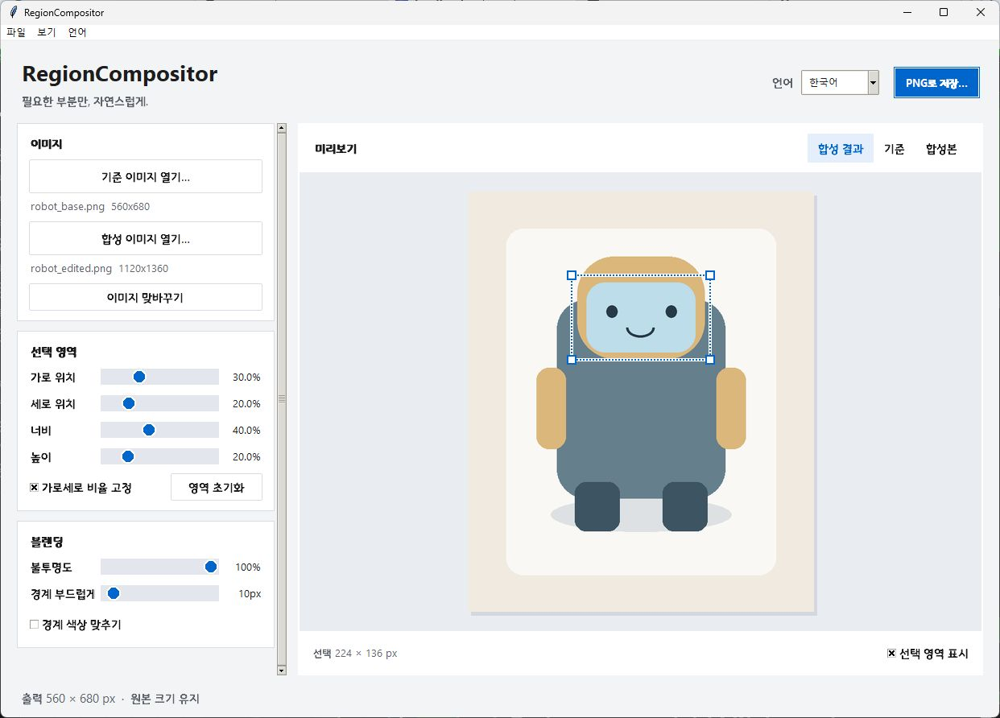

# RegionCompositor

[English](README.md) · [디자인 적용 내용](docs/DESIGN.md)

Stable Diffusion으로 만든 이미지의 원하는 부분만 기준 이미지에 합성하는 데스크톱 프로그램입니다. 스프라이트를 편집할 때 나머지 영역과 원본 해상도를 유지할 수 있습니다. 이미지 처리는 모두 로컬에서 진행되며 모델이나 API 키가 필요하지 않습니다.



## 주요 기능

- PNG, JPEG, WebP, BMP, TIFF 열기 및 파일 드래그앤드롭
- X/Y/너비/높이 슬라이더, 캔버스 드래그, 모서리 핸들로 영역 선택
- 서로 다른 해상도에서도 같은 상대 위치를 선택해 합성
- 불투명도, 경계 부드럽게, 경계 색상 맞추기
- 합성 결과 / 기준 / 합성본 비교
- 한국어·영어 즉시 전환 및 다음 실행까지 언어 설정 유지
- PNG 복사본 저장, 확인 후 기준 파일 덮어쓰기
- 키보드 이동과 작은 창에서 사용할 수 있는 스크롤 조절 패널

## 설치와 실행

**Python 3.10 이상과 Tcl/Tk**가 필요합니다. Windows에서 검증했습니다. 일반 Python 설치 프로그램에서 Tcl/Tk를 포함해 설치한 다음 이 폴더에서 실행하세요.

```powershell
python -m venv .venv
.\.venv\Scripts\python.exe -m pip install -r requirements.txt
.\.venv\Scripts\python.exe region_compositor.py
```

설치 후에는 `run.bat`를 더블클릭해 실행할 수 있습니다. ComfyUI 내장 Python에는 Tkinter가 없을 수 있으므로 일반 Python 설치본을 사용하세요. 드래그앤드롭 구성 요소가 로드되지 않아도 파일 열기 버튼은 사용할 수 있습니다.

## 사용 방법

1. **기준 이미지 열기**로 출력 크기의 기준이 될 이미지를 엽니다.
2. **합성 이미지 열기**로 수정한 이미지를 엽니다.
3. 슬라이더 또는 미리보기 드래그로 교체할 영역을 지정합니다.
4. **불투명도**, **경계 부드럽게**, **경계 색상 맞추기**를 조절합니다.
5. **PNG로 저장**으로 복사본을 만듭니다. 원본을 교체하려면 **파일 → 기준 파일 덮어쓰기**를 선택하고 확인합니다.

기본 프로그램은 두 이미지의 **같은 상대 좌표**를 잘라 합성합니다. 같은 구도의 원본·수정본을 위한 방식입니다. 자동 물체 인식, 배경 제거, 스프라이트 시트 생성 기능은 포함하지 않습니다. 저장 과정에서 원본 EXIF, 생성 프롬프트 메타데이터, 색상 프로필, 다중 프레임은 유지하지 않습니다.

## 언어 전환

오른쪽 위의 **언어** 선택 또는 **언어 메뉴**에서 **한국어 / English**를 고릅니다. 기본 언어는 한국어입니다. 버튼, 메뉴, 안내 문구, 파일 대화상자, 오류 메시지와 상태 표시가 함께 전환됩니다. 열어 둔 이미지와 선택 영역, 블렌딩 설정은 유지됩니다.

Windows 설정 저장 위치: `%LOCALAPPDATA%\RegionCompositor\settings.json`

프로그램이 지정하는 대화상자 제목과 파일 필터는 번역되며, 운영체제 기본 대화상자의 버튼은 Windows 표시 언어를 따릅니다.

새 디자인과 언어 전환의 기본 실행 파일은 `region_compositor.py`입니다. 별도 보관한 과거 v2 화면은 영문 그대로 유지합니다.

## 단축키

| 단축키 | 동작 |
| --- | --- |
| Ctrl+O | 기준 이미지 열기 |
| Ctrl+Shift+O | 합성 이미지 열기 |
| Ctrl+S | PNG 복사본 저장 |
| Ctrl+Shift+S | 확인 후 기준 파일 덮어쓰기 |
| 캔버스를 클릭한 뒤 방향키 | 선택 영역 1픽셀 이동 |
| Shift+방향키 | 10픽셀 이동 |
| Tab / Shift+Tab | 컨트롤 간 이동 |

## EXE 빌드와 테스트

```powershell
.\.venv\Scripts\python.exe -m pip install -r requirements-build.txt
powershell -ExecutionPolicy Bypass -File .\build.ps1
.\.venv\Scripts\python.exe -m unittest discover -s tests -v
```

새 EXE는 `dist/RegionCompositor.exe`에 생성됩니다. 소스 수정만으로 기존 바탕화면의 EXE가 바뀌지는 않습니다. 테스트는 임시 생성 이미지만 사용합니다. GUI 테스트에는 화면과 정상적인 Tcl/Tk 환경이 필요합니다.

## GitHub 비공개 저장소에 올리기

GitHub에서 비공개 저장소를 빈 상태로 만들고, 아래 명령의 계정·이름·이메일을 본인 정보로 바꿔 실행하세요. GitHub 쪽에서 README를 별도로 만들지 않으면 처음 올릴 때 충돌을 피할 수 있습니다.

```powershell
# 이미 Git 저장소로 초기화되어 있다면 생략
git init -b main

# Git 작성자 정보가 없는 경우에만 본인 정보로 설정
git config user.name "YOUR_NAME"
git config user.email "YOUR_GIT_EMAIL"

git add .
git diff --cached --stat
git commit -m "Add bilingual RegionCompositor desktop app"
git remote add origin https://github.com/YOUR_ACCOUNT/RegionCompositor.git
git push -u origin main
```

저장소 주소와 인증 정보는 자동으로 설정하지 않습니다. `origin`이 이미 있으면 `git remote -v`로 먼저 확인하세요. `.gitignore`는 가상환경, 빌드 결과, 실행 파일, 로컬 설정과 작업 이미지를 제외합니다.

## 보관된 이전 버전

- `versions/legacy_compositor.py`: 기존 EXE에서 사용하던 소스를 복구한 버전이며, 현재 합성 로직의 기반입니다.
- `versions/region_compositor_v2.py`: 합성 이미지 전체를 배치하는 별도 실험 버전입니다. `stretch`, `contain`, `cover`, 직접 크기 지정, 검정 배경 마스크 및 CLI를 제공합니다. 기본 프로그램과 합성 방식이 다릅니다.

v2의 실행·CLI 예시는 [영문 README](README.md)를 참고하세요.

## 디자인 참고

[Apple Human Interface Guidelines](https://developer.apple.com/kr/design/human-interface-guidelines)의 시각적 위계, 타이포그래피, 여백, 작업 버튼과 대비 원칙을 참고했습니다. Windows용 Tkinter/ttk 환경에 맞춰 적용했으며, Apple의 글꼴이나 아이콘 파일을 배포하지 않습니다.

## Windows 배포 파일

2026-09-16에 Windows x64 EXE를 빌드하고 이미지 열기·합성·PNG 저장을 확인했습니다. 별도 Python 설치 없이 `RegionCompositor-windows-x64.zip`을 풀고 `RegionCompositor.exe`를 실행하세요. 로컬 EXE는 `dist/`에 있으며, ZIP은 GitHub Releases에 첨부하면 됩니다. [업로드·릴리스 안내](docs/GITHUB_RELEASE.md)를 참고하세요.
