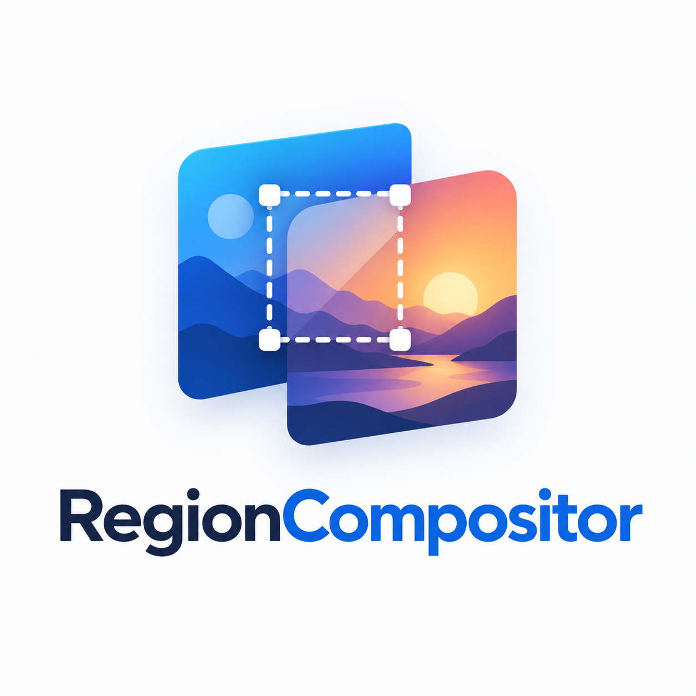

# RegionCompositor



[English](README.md)

Flutter Windows 데스크톱 이미지 영역 합성 앱입니다.
Python/Pillow 합성 엔진은 앱에 포함된 로컬 프로세스로 실행합니다.
설치판은 별도 Python 설치, 서버, AI 모델, API 키가 필요하지 않습니다.

## 다운로드

[최신 릴리스에서 Windows 설치용 EXE 다운로드](https://github.com/noobcoderbkr/Diffusion-sprit-clean/releases/latest)

Setup EXE 하나를 실행하면 앱과 엔진을 함께 설치합니다. 휴대용 ZIP도 제공합니다.

## 기능

- PNG/JPEG/WebP/BMP/TIFF 열기
- 영역 그리기·이동·모서리 크기 조절 및 위치·크기 슬라이더
- 불투명도·경계 부드럽게·경계 색상 맞춤 미리보기
- 입력 파일을 보존하는 원본 해상도 PNG 저장
- 편집 상태를 유지하는 한영 전환 및 언어 설정 저장
- 외부 업로드 없는 로컬 이미지 처리

## 개발 실행과 빌드

Windows x64, Flutter 3.47.8, Python 3.13, Visual Studio C++ 빌드 도구가 필요합니다.

```powershell
.\run.bat
.\build.ps1
```

실행 스크립트가 프로젝트 전용 Python 환경을 준비하고 Flutter를 시작합니다.
빌드는 테스트를 실행하고 Python 엔진을 Windows 앱과 함께 패키징합니다.
[실행·빌드·설치 안내](docs/FLUTTER_WINDOWS.md),
[검증 결과](docs/FLUTTER_VALIDATION.md), [로고 기록](docs/BRANDING.md)를 참고하세요.

## 구성

- `flutter_app/`: 메인 앱과 Windows 실행기
- `backend/`: 화면 없는 Python/Pillow 엔진
- `tests/`: 합성 결과 기준값 및 worker 연동 테스트
- `scripts/`, `packaging/`: 실행·빌드·단일 설치 EXE 제작

## 라이선스

사용자 코드에는 [비상업적 사용·재배포 금지 라이선스](LICENSE)가 적용됩니다.
[제3자 구성요소](docs/THIRD_PARTY_NOTICES.md)에는 각각의 라이선스가 적용됩니다.
