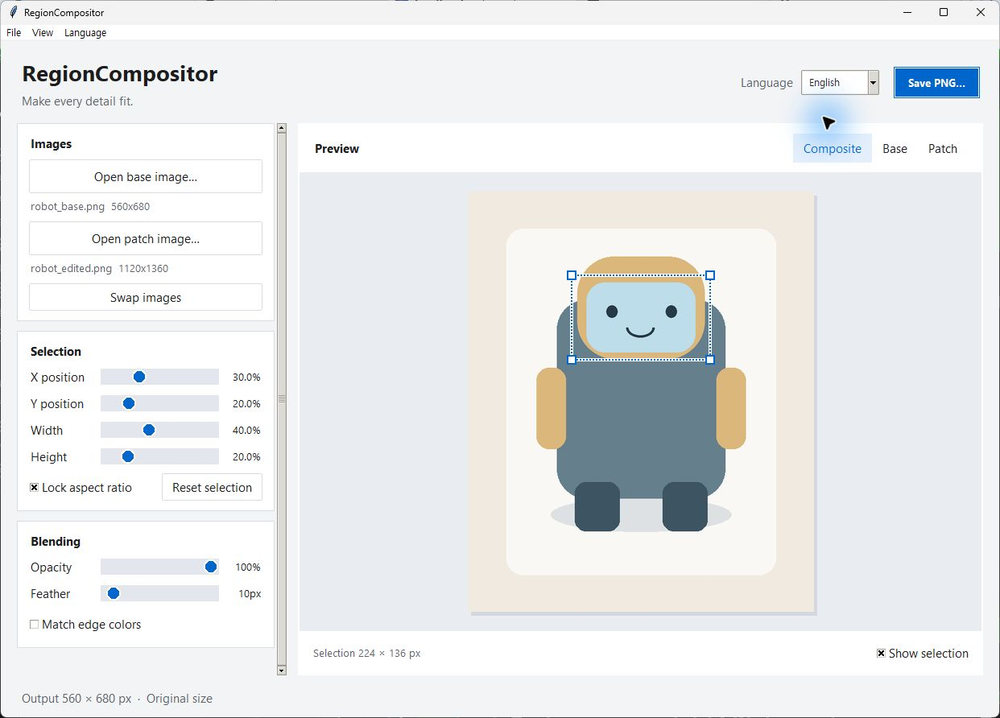

# RegionCompositor


[한국어](README.ko.md) · [Design notes](docs/DESIGN.md) · [Source recovery](docs/RECOVERY.md)

A small desktop tool for blending a selected area from an edited image into a base image. Use it to prepare sprites from Stable Diffusion images while keeping the rest of the base image unchanged. All image processing runs locally; no model, server, or API key is required.



## Features

- Open PNG, JPEG, WebP, BMP, or TIFF images, including drag and drop.
- Select an area with X/Y/width/height sliders, canvas dragging, or corner handles.
- Match the same relative area across images with different resolutions.
- Adjust opacity, feathering, and edge color matching.
- Switch between composite, base, and patch previews.
- Switch between **한국어** and **English** immediately, without losing the current edit.
- Save a separate PNG, or explicitly replace the base file after confirmation.
- Keyboard shortcuts, focusable controls, and a scrollable inspector for smaller windows.

## Install and run

Requires **Python 3.10 or newer**, with **Tcl/Tk** included. Windows is the tested platform. On Windows, install standard Python with the Tcl/Tk option enabled, then run these commands inside this folder:

```powershell
python -m venv .venv
.\.venv\Scripts\python.exe -m pip install -r requirements.txt
.\.venv\Scripts\python.exe region_compositor.py
```

After setup, you can also double-click `run.bat`. A ComfyUI embedded Python installation may not include Tkinter; use a standard Python installation for this GUI.

`tkinterdnd2` enables drag and drop. If its native component cannot load, the Open buttons remain available.

## Editing workflow

1. Choose **Open base image**. Its pixel dimensions determine the output dimensions.
2. Choose **Open patch image** to load the edited version.
3. Position the selection using the inspector, the canvas, or its corner handles.
4. Adjust **Opacity**, **Feather**, and **Match edge colors**.
5. Use **Save PNG** to save a copy. To replace the original, choose **File → Replace base file** and confirm.

The main app crops the **same relative coordinates** from both images. It is intended for aligned versions of the same composition, not for placing an unrelated cutout. It does not automatically detect objects, remove backgrounds, or create sprite sheets.

Saving re-encodes the image. Original EXIF, Stable Diffusion generation metadata, color profiles, and multi-frame content are not retained.

## Language

Use the top-right **Language** selector or the **Language** menu. Korean is the initial default. Buttons, menus, empty states, file dialogs, validation messages, and status text change together. Selected images, selection coordinates, and blend settings remain intact.

The preference is stored outside the repository:

- Windows: `%LOCALAPPDATA%\RegionCompositor\settings.json`
- Other platforms: `$XDG_CONFIG_HOME/RegionCompositor/settings.json`, or `~/.config/RegionCompositor/settings.json`

App-provided dialog titles and file filters are translated. Operating-system dialog buttons follow the Windows display language. The separate historical v2 interface remains English-only; the redesigned bilingual interface is `region_compositor.py`.

## Keyboard shortcuts

| Shortcut | Action |
| --- | --- |
| Ctrl+O | Open base image |
| Ctrl+Shift+O | Open patch image |
| Ctrl+S | Save a PNG copy |
| Ctrl+Shift+S | Replace base file, with confirmation |
| Arrow keys, with canvas focused | Move the selection by one base-image pixel |
| Shift+Arrow keys | Move by ten pixels |
| Tab / Shift+Tab | Move between controls |

## Build a Windows executable

```powershell
.\.venv\Scripts\python.exe -m pip install -r requirements-build.txt
powershell -ExecutionPolicy Bypass -File .\build.ps1
```

The output is `dist/RegionCompositor.exe`. Build from the repository root using a Python installation with working Tcl/Tk. Build products and virtual environments are excluded from Git. The original Desktop executable is not automatically updated by source changes.

## Tests

```powershell
.\.venv\Scripts\python.exe -m unittest discover -s tests -v
```

Tests use generated images and temporary directories. They cover compositing boundaries, scaling, feathering, file replacement, language switching, preference persistence, save cancellation, and drop paths containing Korean text and spaces. GUI tests require a working display and Tcl/Tk; otherwise they are reported as skipped.

## Upload to your own GitHub repository

Create an empty **private** repository on GitHub. Do not initialize a second README there. From this folder:

```powershell
# Initialize only if this folder is not already a Git repository.
git init -b main

# Set these only if you have not configured your Git identity yet.
git config user.name "YOUR_NAME"
git config user.email "YOUR_GIT_EMAIL"

git add .
git diff --cached --stat
git commit -m "Add bilingual RegionCompositor desktop app"
git remote add origin https://github.com/YOUR_ACCOUNT/RegionCompositor.git
git push -u origin main
```

Replace the account and identity placeholders with your own values. GitHub authentication happens through your Git client. This project does not include a token or configure a remote automatically. If `origin` already exists, inspect it with `git remote -v` before changing it.

## Flutter Windows UI (feature branch)

The Flutter main app runs the preserved Pillow algorithm in an app-managed,
bundled local Python worker. It supports image open, region drawing/moving/
resizing, blend preview, full-resolution PNG export, and Korean/English switching.
The v0.1.0 Tk app remains available unchanged. See the
[Flutter run/build guide](docs/FLUTTER_WINDOWS.md),
[validation](docs/FLUTTER_VALIDATION.md), and
[license inventory](docs/THIRD_PARTY_NOTICES.md).
The project author's terms are in [LICENSE](LICENSE); third-party terms remain separate.

## Project layout

```text
region_compositor.py          Application entry point
compositor_app.py             Bilingual interface and save/open workflow
ui_support.py                Translations and preference storage
versions/legacy_compositor.py Preserved original logic and historical interface
versions/region_compositor_v2.py  Historical whole-patch compositor and CLI
tests/                       Automated tests
docs/                        Design and recovery notes
```

The main app reuses the original compositing implementation. `versions/legacy_compositor.py` can also run independently to inspect the recovered historical UI.

The v2 variant fits the entire patch into a destination area using `stretch`, `contain`, or `cover`, with configurable sizing and a black-to-alpha mask. It is preserved separately because its compositing behavior differs:

```powershell
.\.venv\Scripts\python.exe versions\region_compositor_v2.py
.\.venv\Scripts\python.exe versions\region_compositor_v2.py --base base.png --patch patch.png --out result.png --x 100 --y 100 --w 300 --h 400 --fit-mode contain --no-black-to-alpha
```

## Design reference

The desktop layout draws on Apple's [Human Interface Guidelines](https://developer.apple.com/kr/design/human-interface-guidelines): clear hierarchy, readable typography, focused toolbars, and accessible contrast. It uses portable Tkinter/ttk controls and Windows system fonts; it is not a native macOS application. See [the design notes](docs/DESIGN.md) for the specific choices and references.

## Windows release

The Windows x64 executable was built and smoke-tested on 2026-09-16. It runs without a separate Python installation. Extract `RegionCompositor-windows-x64.zip` and launch `RegionCompositor.exe`. Local build output is in `dist/`; upload the ZIP as a GitHub Release asset. See [upload and release instructions](docs/GITHUB_RELEASE.md) and [validation](docs/VALIDATION.md).
